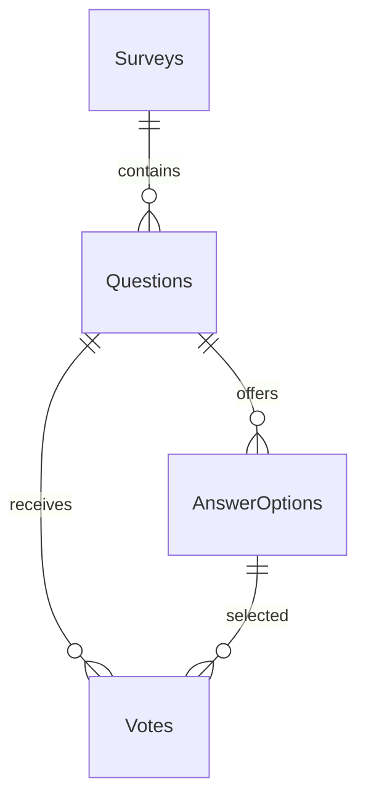

# Документация на дипломния проект

**Работна тема:** „Разработка на платформа за провеждане на интерактивни анкети на живо с присъединяване чрез код или QR код и визуализация на резултатите в реално време“.

Това е начална документация за текущия етап. Окончателното заглавие трябва да съвпада с подписаното индивидуално задание. Документът не представлява завършена дипломна работа с обем от 30 страници.

## Съдържание

1. [Увод](#1-увод)
2. [Глава 1. Проучвателна част](#2-глава-1-проучвателна-част)
3. [Глава 2. Изисквания към програмния продукт](#3-глава-2-изисквания-към-програмния-продукт)
4. [Глава 3. Проектен цикъл на приложението](#4-глава-3-проектен-цикъл-на-приложението)
5. [Глава 4. Ръководство за потребителя](#5-глава-4-ръководство-за-потребителя)
6. [Състояние на текущия етап](#6-състояние-на-текущия-етап)
7. [Информационни източници](#7-информационни-източници)

## 1. Увод

При провеждане на учебни занятия, презентации и дискусии възниква необходимост от събиране на мнения и бързо обобщаване на отговорите на участниците. Устното задаване на въпроси и ръчното преброяване на отговорите могат да затруднят работата с по-голяма група. Уеб приложение за интерактивни анкети позволява участниците да отговарят от собствените си устройства, а водещият да наблюдава обобщените резултати по време на събитието.

Актуалността на темата се свързва с необходимостта от достъпна обратна връзка в рамките на провежданото занятие или представяне. Съществуващи решения като Mentimeter и Slido използват присъединяване чрез код или QR код [1, 6]. Настоящият проект разглежда разработването на собствено приложение с ограничен и ясно определен набор от функции, насочени към създаване на анкети, участие в тях и представяне на резултатите.

**Обект на разработката** е процесът на провеждане на интерактивни анкети с група участници по време на общо събитие.

**Предмет на разработката** са софтуерните средства за управление на анкетите, присъединяване към активна сесия, съхраняване на отговорите и актуализиране на резултатите в реално време.

**Целта на дипломния проект** е да се разработи уеб платформа, чрез която водещ да създава и провежда анкети на живо, участниците да се присъединяват чрез код или QR код, а постъпилите отговори да се представят графично без ръчно презареждане на страницата.

За постигане на целта се поставят следните основни задачи:

1. Да се проучат сходни приложения и подходите за присъединяване и обмен на данни в реално време.
2. Да се определят потребителските роли, функционалните изисквания и границите на първата версия.
3. Да се изберат технологии за сървърната част, клиентския интерфейс и съхраняването на данните.
4. Да се проектират структурата на приложението и релационният модел на базата данни.
5. Да се реализират създаване на анкети, управление на провеждането им и присъединяване на участници.
6. Да се реализират приемане и валидиране на отговорите и визуализация на обобщените резултати в реално време.
7. Да се проверят основните потребителски сценарии и да се подготвят указания за стартиране и използване.

**Очакваният краен резултат** е работещо приложение с два основни режима: управление от водещ и участие в анкета. Водещият ще може да подготвя въпроси с един избираем отговор, да споделя начин за присъединяване и да наблюдава графика с броя и процента на гласовете. Участникът ще може да отговаря през браузър без създаване на профил. Кодът, моделът на данните, тестовете и документацията ще бъдат поддържани в GitHub хранилище.

Методите на работа включват сравнително проучване на съществуващи решения, анализ на изискванията, моделиране на базата данни, поетапна реализация и проверка чрез тестови сценарии. На настоящия етап се подготвят документацията, структурата на приложението и началната база данни. Реализацията на всички крайни функционалности предстои.

## 2. Глава 1. Проучвателна част

### 2.1. Сходни решения

Предварителното проучване използва официални материали на Mentimeter и Slido. Разгледани са начините за достъп до анкета и използването им при представяне пред публика. Не са извършвани практически изпитвания на тези продукти или сравнение на платените им планове.

| Решение | Установено от официалните материали | Приложение в проекта |
| --- | --- | --- |
| Mentimeter | Участие чрез връзка, QR код или код за присъединяване при Menti Live [1] | Да се предвидят кратък код и QR код към една и съща сесия |
| Slido | Представяне на код и QR код пред аудиторията и участие в анкети през собствено устройство [6] | Да се разделят екранът на водещия и интерфейсът на участника |

**Извод:** избраните механизми за присъединяване са подходяща отправна точка за проекта. Собствената разработка ще се ограничи до анкети с един избираем отговор и обобщени резултати. В първата версия не се предвиждат презентационен редактор, викторини с класиране и текстови облаци.

### 2.2. Технологичен избор

| Технология | Предназначение и основание за избора |
| --- | --- |
| C# и ASP.NET Core | Сървърно приложение с HTTP API и вграден механизъм за внедряване на зависимости [2] |
| Entity Framework Core | Описване на таблиците чрез C# модели, заявки и проследими промени по схемата чрез миграции [3] |
| SQLite | Локална релационна база във файл, използвана чрез официалния EF Core доставчик; улеснява първоначалното стартиране [4] |
| HTML, CSS и JavaScript | Интерфейс в браузър без допълнителна клиентска рамка и отделен процес за компилиране |
| ASP.NET Core SignalR | Планиран канал за изпращане на промени от сървъра към свързаните браузъри [5] |

SQLite е избрана за началния етап, а не въз основа на измерена производителност при голям брой участници. При промяна на доставчика към SQL Server ще трябва да се прегледат типовете, заявките и миграциите. JavaScript без рамка е достатъчен за планираните няколко екрана и поддържа малък обем на началния код.

За обновяването на резултатите са разгледани периодични HTTP заявки и SignalR. Избран е SignalR, за да може сървърът да изпраща известие при промяна. След повторно свързване клиентът ще трябва да изтегля актуалните резултати от базата, вместо да разчита само на пропуснатите събития [5]. Това е проектно решение за следващ етап.

## 3. Глава 2. Изисквания към програмния продукт

### 3.1. Концепция и роли

Платформата е предназначена за учебни занятия и представяния пред група. Водещият подготвя анкета, отваря я за участие и показва код или QR код. Участниците се присъединяват през браузър и изпращат отговор за текущия въпрос. Сървърът записва отговора, изчислява общите стойности и известява екраните за резултати.

Предвиждат се две роли:

- **Водещ:** има профил и управлява само собствените си анкети и сесии.
- **Участник:** присъединява се без профил и отговаря на отворените за гласуване въпроси.

Профилите и контролирането на достъпа на водещия предстоят. Началният прототип предоставя само публичен преглед на демонстрационна анкета.

### 3.2. Планирани функционални изисквания

| № | Изискване | Проверим очакван резултат |
| --- | --- | --- |
| F1 | Вход на водещ | Водещият получава достъп до своите анкети |
| F2 | Създаване на анкета и въпроси | Записват се заглавие, въпроси и от 2 до 6 варианта за всеки въпрос |
| F3 | Управление на сесия | Водещият отваря, сменя въпрос и приключва гласуването |
| F4 | Присъединяване чрез код | Валиден код отваря съответната активна сесия; невалиден код показва разбираема грешка |
| F5 | Присъединяване чрез QR код | Сканирането отваря същата връзка за участие като ръчно въведения код |
| F6 | Подаване на отговор | Приема се само вариант към текущия въпрос в активна сесия |
| F7 | Ограничаване на повторен отговор | За един идентификатор на участник се записва най-много един отговор на въпрос в сесия |
| F8 | Резултати в реално време | Графиката се обновява след нов отговор без ръчно презареждане |

Ограничението за повторно гласуване ще се основава на идентификатор на браузърна сесия. Без регистрация това не доказва уникалността на човека: друг браузър или изтриване на локалните данни може да позволи ново участие.

### 3.3. Нефункционални изисквания

- Интерфейсът да бъде на български и да се използва от телефон и компютър.
- Данните да се валидират на сървъра; чужди варианти и повторни отговори да се отхвърлят.
- Пароли и ключове да не се съхраняват в хранилището.
- Да се поддържа ясна структура с контролери, модели и контекст на базата, без излишни междинни слоеве.
- Да има възпроизводимо създаване на базата чрез миграции.
- При бъдещо тестване с 30 едновременно свързани клиента в локална мрежа да се провери целево обновяване на резултатите до 2 секунди след приет отговор. Това е цел за измерване, а не постигнат резултат.

## 4. Глава 3. Проектен цикъл на приложението

### 4.1. Начална архитектура

Едно ASP.NET Core приложение обслужва статичния JavaScript интерфейс и HTTP API. Контролерите използват EF Core контекст за достъп до SQLite. Не се въвеждат отделни проекти за всеки слой или допълнителен repository слой върху EF Core.

```text
JavaScript интерфейс → HTTP контролер → EF Core → SQLite
```

На следващ етап ще се добави SignalR канал за известяване за нов отговор и промяна на активния въпрос. Първо ще се запазват данните, след което ще се изпраща известието.

### 4.2. Начален модел на базата данни

Началният модел съдържа четири таблици. В него една анкета представлява едно провеждане. Отделянето на многократни сесии и добавянето на профили са планирани за следваща миграция.

| Таблица | Основни полета | Предназначение |
| --- | --- | --- |
| Surveys | Id, Title, JoinCode, IsActive, CreatedAt | Анкета с уникален шестцифрен код |
| Questions | Id, SurveyId, Text, Position | Подредени въпроси към анкета |
| AnswerOptions | Id, QuestionId, Text, Position | Варианти за отговор към въпрос |
| Votes | Id, QuestionId, AnswerOptionId, ParticipantId, CreatedAt | Отговор на участник към конкретен въпрос |

**Фигура 1. Начални връзки между таблиците.** Схемата показва принадлежността на въпросите към анкета и на вариантите и отговорите към въпрос.



Ограничения в базата:

- JoinCode е уникален и съдържа шест цифри.
- Двойката SurveyId и Position е уникална за въпросите.
- Двойката QuestionId и Position е уникална за вариантите.
- Двойката QuestionId и ParticipantId е уникална за отговорите.
- Съставен външен ключ от Votes към AnswerOptions гарантира, че избраният вариант принадлежи на посочения въпрос.
- Празни заглавия, въпроси, варианти и идентификатори на участници не се допускат.

Началната база не съхранява имена или електронни адреси на участниците. Демонстрационните данни съдържат една неактивна анкета и един въпрос. Не се добавят измислени гласове.

### 4.3. План за следващата работа

| Етап | Задачи | Условие за приключване |
| --- | --- | --- |
| Настоящ | Концепция, проучване, увод, структура, миграция и база | Проектът се стартира и показва записана демонстрационна анкета |
| Следващ 1 | Профили на водещи, собственост и създаване на анкети | Водещият може да управлява само собствените си данни |
| Следващ 2 | Сесии, активен въпрос, код и QR | Два различни браузъра достигат до една и съща активна сесия |
| Следващ 3 | Отговори, валидация, SignalR и графика | Нов отговор се записва и резултатът се обновява на друг екран |
| Следващ 4 | Проверки, обработка на грешки и документация | Основните сценарии са проверени и описани за демонстрация |

Всеки следващ етап се предвижда като приблизително една работна седмица с консултация в края. Точните дати ще се определят според училищния график и индивидуалното задание.

## 5. Глава 4. Ръководство за потребителя

За настоящия етап ръководството обхваща само стартирането и прегледа на демонстрационните данни. Командите и адресите са описани в основния README на хранилището. Инструкциите за водещ и участник ще се допълват след реализацията на съответните функции.

## 6. Състояние на текущия етап

Този документ определя концепцията, целта, задачите, очакваните резултати и основния предварителен технологичен избор. Началната структура и базата данни служат като техническа основа за следващите етапи. Окончателно заключение за резултатите от дипломната работа ще бъде написано след реализацията и проверката на приложението.

Документацията се намира в публичното хранилище и може да бъде четена без покана. За пряк преглед се предоставя връзката към този файл. Права за редактиране или сътрудничество не са предоставяни на конкретен консултант, тъй като не е посочен негов GitHub профил.

При пренасяне в официалния училищен шаблон трябва да се запазят неговите раздели и стилове, да се добавят титулната страница и утвърденото задание и да се приложат зададените полета, междуредие, номерация и автоматично съдържание. Посочената в примерния шаблон сесия не се приема автоматично за действителния срок на проекта.

## 7. Информационни източници

Използваните източници са интернет материали, подредени по организация. Номерата в квадратни скоби в текста препращат към списъка. Не са добавяни неизползвани печатни източници.

1. Mentimeter. *How to participate in a Menti*. [Официална документация](https://help.mentimeter.com/en/articles/410537-how-to-participate-in-a-menti).
2. Microsoft. *Overview of ASP.NET Core*. [Официална документация](https://learn.microsoft.com/en-us/aspnet/core/introduction-to-aspnet-core).
3. Microsoft. *Migrations Overview — EF Core*. [Официална документация](https://learn.microsoft.com/en-us/ef/core/managing-schemas/migrations/).
4. Microsoft. *SQLite EF Core Database Provider*. [Официална документация](https://learn.microsoft.com/en-us/ef/core/providers/sqlite/).
5. Microsoft. *ASP.NET Core SignalR JavaScript client*. [Официална документация](https://learn.microsoft.com/en-us/aspnet/core/signalr/javascript-client).
6. Slido. *Use Slido with a QR code*. [Официален помощен материал](https://community.slido.com/presenter-best-practices-214/use-slido-with-a-qr-code-529).
